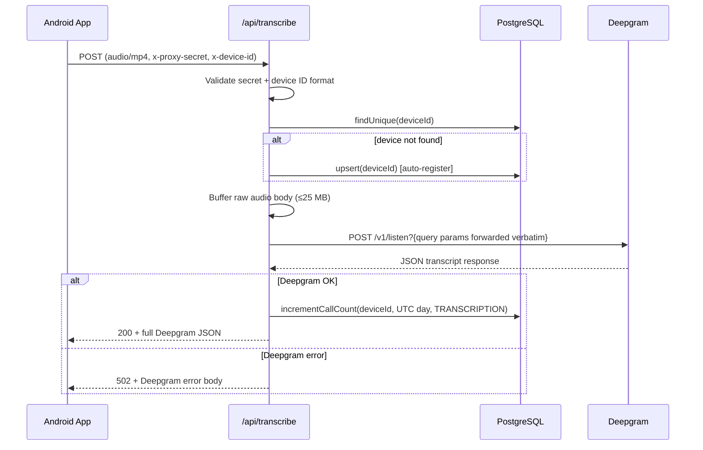
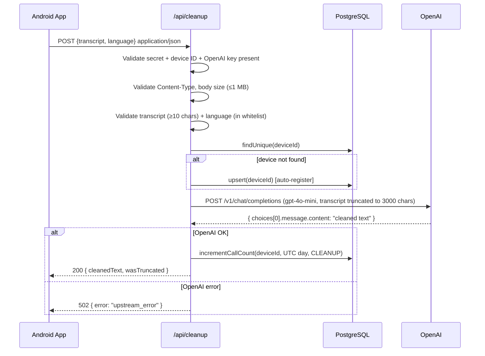

# wrait-backend — Complete Codebase Knowledge Document

> **Audience:** An LLM or engineer arriving cold who needs to implement features, fix bugs, or refactor safely.
> **Status:** Generated 2026-04-17 from direct source analysis of commit `8b17020`.

---

## Table of Contents

1. [High-Level Overview](#1-high-level-overview)
0. [Issues & Findings](#0-issues--findings) ← **start here for code review**
2. [Architecture & Component Map](#2-architecture--component-map)
3. [Data Flow Diagrams](#3-data-flow-diagrams)
4. [Feature-by-Feature Analysis](#4-feature-by-feature-analysis)
   - 4.1 [Health Check — `GET /api/hello`](#41-health-check--get-apihello)
   - 4.2 [Device Registration — `POST /api/register`](#42-device-registration--post-apiregister)
   - 4.3 [Transcription Proxy — `POST /api/transcribe`](#43-transcription-proxy--post-apitranscribe)
   - 4.4 [Transcript Cleanup — `POST /api/cleanup`](#44-transcript-cleanup--post-apicleanup)
   - 4.5 [Call Count Tracking](#45-call-count-tracking)
5. [Database Schema & Migration History](#5-database-schema--migration-history)
6. [Shared Library Reference](#6-shared-library-reference)
7. [Security Model](#7-security-model)
8. [Deployment Configuration](#8-deployment-configuration)
9. [Testing Strategy](#9-testing-strategy)
10. [Nuances, Gotchas & Things You Must Know Before Changing Code](#10-nuances-gotchas--things-you-must-know-before-changing-code)
11. [Environment Variables Reference](#11-environment-variables-reference)
12. [Glossary & Domain Terms](#12-glossary--domain-terms)
13. [Cross-Feature Interaction Map](#13-cross-feature-interaction-map)
14. [File Index & Priority](#14-file-index--priority)

---

---

## 0. Issues & Findings

> Ranked P0 (critical) → P3 (low). Fix P0s before any new feature work.

---

### P0 — Critical

---

#### P0-1 · PROXY_SECRET value logged in plaintext on auth failure

**File:** [`api/register.ts:14`](../api/register.ts)

```typescript
console.error('PROXY SECRET MISMATCH', proxySecret, process.env.PROXY_SECRET);
```

**Impact:** Every failed authentication attempt writes the actual `PROXY_SECRET` value to Vercel's function logs. Anyone with read access to Vercel logs (team members, compromised CI token, Vercel support) can extract the secret. Once the secret is known, any caller can impersonate the app.

**Why it's P0:** This is not a theoretical risk — the secret is actively logged on every wrong-secret request. An attacker doesn't need to break anything; they just need log access.

**Fix:**

```typescript
// Before
console.error('PROXY SECRET MISMATCH', proxySecret, process.env.PROXY_SECRET);

// After
console.error('PROXY_SECRET mismatch — rejecting request');
```

**Note:** The `transcribe` and `cleanup` handlers do NOT log the secret on mismatch. Only `register.ts` has this bug.

---

#### P0-2 · `DATABASE_URL_UNPOOLED` not set in `.env` — migrations run against the pooled connection

**File:** [`prisma.config.ts`](../prisma.config.ts), [`.env`](../.env)

**Impact:** The `.env` file has `DATABASE_URL_UNPOOLED` commented out. `prisma.config.ts` falls back to `DATABASE_URL` (the pgBouncer-pooled URL) for migrations. Prisma's migration engine uses advisory locks and multi-statement transactions that are incompatible with pgBouncer in transaction-pooling mode. Migrations may silently succeed locally but fail or corrupt state on the real DB — or block indefinitely waiting for a lock that pgBouncer breaks.

**Fix:** Uncomment and populate `DATABASE_URL_UNPOOLED` in `.env` (and in Vercel env settings) with the direct non-pooled Neon connection string. The unpooled URL is available in the Neon dashboard.

---

### P1 — High

---

#### P1-1 · No rate limiting — unlimited API spend per device

**Files:** [`api/transcribe.ts`](../api/transcribe.ts), [`api/cleanup.ts`](../api/cleanup.ts), [`src/lib/callCount.ts`](../src/lib/callCount.ts)

**Impact:** Any device holding a valid `PROXY_SECRET` can make unlimited calls to Deepgram and OpenAI. A single compromised APK (secret extracted via reverse engineering) or a buggy client stuck in a retry loop could generate unbounded costs. The `call_counts` table is populated but never read by any handler — it is infrastructure with no enforcement logic wired up.

**Risk surface:** Deepgram and OpenAI are billed per usage. A single device looping audio 24/7 at Deepgram's nova-3 rate would cost ~$120+/day.

**Fix (minimum viable):** Add a daily limit check at the top of both handlers, before the upstream call:

```typescript
const todayCount = await prisma.callCount.findUnique({
  where: { deviceId_date_type: { deviceId, date: getUTCDayBucket(), type } },
});
if (todayCount && todayCount.count >= DAILY_LIMIT) {
  return json(res, { error: 'Daily limit reached' }, 429);
}
```

Define `DAILY_LIMIT` as a constant or env var. Add this before the Deepgram/OpenAI fetch.

---

#### P1-2 · All devices share one `PROXY_SECRET` — no revocation granularity

**Impact:** The `PROXY_SECRET` is compiled into every APK binary. APK reverse-engineering (trivial with tools like `apktool`) exposes the secret. Once extracted, it is valid for every device and every endpoint indefinitely. There is no mechanism to revoke access for a specific device or a specific APK version without rotating the secret for all users simultaneously.

**Fix options (in order of increasing effort):**
1. **Short-term:** Rotate the secret on each APK release; old versions stop working.
2. **Medium-term:** Move to per-device signed JWT (device generates a key pair; backend verifies signature). The `deviceId` is already a stable identity anchor.
3. **Long-term:** Backend issues a time-limited token at registration; device refreshes it periodically.

---

#### P1-3 · `PROXY_SECRET` comparison is not timing-safe

**Files:** [`api/register.ts:13`](../api/register.ts), [`api/transcribe.ts:13`](../api/transcribe.ts), [`api/cleanup.ts:42`](../api/cleanup.ts)

```typescript
if (req.headers['x-proxy-secret'] !== process.env.PROXY_SECRET)
```

JavaScript's `!==` on strings short-circuits at the first differing character, leaking timing information. A timing attack can recover the secret one character at a time by measuring how long the comparison takes.

**Mitigating factors:** Network jitter in a serverless environment makes this significantly harder than in a local LAN context. Still, this is a trivially fixed best-practice violation.

**Fix:**

```typescript
import { timingSafeEqual, createHash } from 'crypto';

function isValidSecret(received: string | string[] | undefined): boolean {
  if (!received || typeof received !== 'string') return false;
  const expected = process.env.PROXY_SECRET ?? '';
  if (received.length !== expected.length) return false;
  return timingSafeEqual(Buffer.from(received), Buffer.from(expected));
}
```

Apply in all three handlers.

---

#### P1-4 · `api/transcribe.ts` has no guard for missing `DEEPGRAM_API_KEY`

**File:** [`api/transcribe.ts:79-86`](../api/transcribe.ts)

**Impact:** If `DEEPGRAM_API_KEY` is not set in the Vercel environment, the handler silently sends `Authorization: Token undefined` to Deepgram. Deepgram returns a 401, which the handler forwards as a 502 to the client. The root cause (missing env var) is invisible.

**Compare:** `api/cleanup.ts` correctly checks for `OPENAI_API_KEY` at the top and returns `500 { error: 'Configuration error' }` if absent (line 50–52).

**Fix:** Add the same guard at the top of `api/transcribe.ts`:

```typescript
if (!process.env.DEEPGRAM_API_KEY) {
  return json(res, { error: 'Configuration error' }, 500);
}
```

---

### P2 — Medium

---

#### P2-1 · Duplicated device-lookup + auto-registration block in two handlers

**Files:** [`api/transcribe.ts:29-47`](../api/transcribe.ts), [`api/cleanup.ts:85-104`](../api/cleanup.ts)

Both handlers contain ~20 lines of identical code:

```typescript
const device = await prisma.device.findUnique({ where: { deviceId }, select: { deviceId: true } });
if (!device) {
  await prisma.device.upsert({ where: { deviceId }, update: {}, create: { deviceId } });
  console.log('[X] Auto-registered device from X endpoint', { deviceId });
}
// catch block with identical error handling
```

**Impact:** Any change to this logic (e.g., adding a `lastSeenAt` field, changing the log message format, or adding a rate-limit pre-check) must be applied in two places. Divergence has already occurred — the log prefix (`[transcribe]` vs `[cleanup]`) is the only difference.

**Fix:** Extract to `src/lib/device.ts`:

```typescript
export async function ensureDevice(deviceId: string, label: string): Promise<void> {
  const device = await prisma.device.findUnique({ where: { deviceId }, select: { deviceId: true } });
  if (!device) {
    await prisma.device.upsert({ where: { deviceId }, update: {}, create: { deviceId } });
    console.log(`[${label}] Auto-registered device`, { deviceId });
  }
}
```

---

#### P2-2 · Deepgram query parameters are fully client-controlled without any validation

**File:** [`api/transcribe.ts:69`](../api/transcribe.ts)

```typescript
const { search } = new URL(req.url!, `https://${req.headers.host}`);
fetch(`https://api.deepgram.com/v1/listen${search}`, ...);
```

The entire query string is forwarded verbatim. A client can inject any Deepgram option: `diarize=true`, `redact=pci`, `summarize=true`, etc. Some Deepgram features are add-ons with separate billing. A malicious or misconfigured client could silently activate paid features.

**Fix (minimum):** Define an allowlist of forwarded parameters:

```typescript
const ALLOWED_DG_PARAMS = new Set(['model', 'language', 'punctuate', 'smart_format', 'detect_language', 'utterances']);
const inbound = new URL(req.url!, `https://${req.headers.host}`);
const outbound = new URLSearchParams();
for (const [k, v] of inbound.searchParams) {
  if (ALLOWED_DG_PARAMS.has(k)) outbound.set(k, v);
}
fetch(`https://api.deepgram.com/v1/listen?${outbound}`, ...);
```

---

#### P2-3 · Inconsistent error response format between `transcribe` and `cleanup`

**Impact:** Client-side error handling must special-case two different error formats for the same class of upstream failure.

| Scenario | `transcribe` error body | `cleanup` error body |
|---|---|---|
| Network error | `{ error: 'Failed to reach Deepgram' }` | `{ error: 'upstream_error' }` |
| Upstream non-200 | _(Deepgram error JSON passed through)_ | `{ error: 'upstream_error' }` |
| Invalid upstream JSON | `{ error: 'Invalid response from upstream' }` | `{ error: 'upstream_error' }` |
| Timeout | `{ error: 'Deepgram request timeout' }` | `{ error: 'OpenAI request timeout' }` |

The `cleanup` endpoint collapses all 502 conditions into a single opaque `'upstream_error'` string, making it impossible for the client to distinguish a network failure from a malformed OpenAI response.

**Fix:** Define a consistent error vocabulary shared by both handlers (e.g., `'upstream_unreachable'`, `'upstream_timeout'`, `'upstream_invalid_response'`).

---

#### P2-4 · `incrementCallCount` is awaited and adds latency on retries

**File:** [`src/lib/callCount.ts:24-27`](../src/lib/callCount.ts)

The retry schedule is `[0ms, 25ms, 75ms]`. In the worst case (3 failed transient attempts), the counter write adds **100ms** of blocking latency to the end of the handler response — after the upstream call already succeeded. The response to the client is held while the retry loop runs.

**Impact on UX:** A DB hiccup during the counter write delays the transcription result reaching the Android app by up to 100ms. Since the counter is declared best-effort ("never fails the response"), it should not add observable latency.

**Fix:** Fire without awaiting the result:

```typescript
// In transcribe.ts / cleanup.ts — don't await
incrementCallCount(deviceId, getUTCDayBucket(), CallCountType.TRANSCRIPTION, 'transcribe');
return json(res, payload, 200);
```

The function already never throws, so removing `await` is safe. The background promise will complete after the response is sent.

---

#### P2-5 · No database foreign key between `call_counts` and `devices`

**File:** [`prisma/schema.prisma`](../prisma/schema.prisma)

`call_counts.device_id` has no `@relation` or DB-level FK to `devices.device_id`. The relationship is enforced only by application code (auto-registration). A bug, direct SQL insert, or race condition can create orphan `call_counts` rows for device IDs that don't exist in `devices`.

**Fix:** Add the relation in Prisma schema:

```prisma
model CallCount {
  deviceId String        @map("device_id")
  device   Device        @relation(fields: [deviceId], references: [deviceId])
  ...
}

model Device {
  ...
  callCounts CallCount[]
}
```

Then generate and apply a migration. The FK will enforce referential integrity at the DB level.

---

#### P2-6 · `Buffer.from(chunk as ArrayBuffer)` in body-buffering loop creates unnecessary copies

**Files:** [`api/transcribe.ts:59`](../api/transcribe.ts), [`api/cleanup.ts:62`](../api/cleanup.ts)

```typescript
chunks.push(Buffer.from(chunk as ArrayBuffer));  // transcribe.ts
chunks.push(Buffer.from(chunk as Buffer));        // cleanup.ts
```

Node.js stream chunks are already `Buffer` instances. `Buffer.from(Buffer)` allocates a new Buffer and copies all bytes into it on every chunk. For a 25 MB audio file split into many chunks, this doubles peak memory usage during buffering.

**Fix:**

```typescript
chunks.push(chunk as Buffer);
```

The `Buffer.concat(chunks)` call at the end already creates the final copy, so the intermediate copies are wasted work.

---

#### P2-7 · `TRANSCRIPT_MIN_LENGTH` check uses `.trim()` but `TRANSCRIPT_MAX_LENGTH` slice does not

**File:** [`api/cleanup.ts:76,129`](../api/cleanup.ts)

```typescript
// Min-length check — trims first
if (body.transcript.trim().length < TRANSCRIPT_MIN_LENGTH) { ... }

// Max-length truncation — does NOT trim
transcript.slice(0, TRANSCRIPT_MAX_LENGTH)
```

A transcript of `" ".repeat(9) + "a"` (9 spaces + 1 char) passes the min-length check (trimmed length = 1, which is < 10... actually fails). But a transcript of `"   " + "hello world"` (3 leading spaces) has trimmed length 11 — passes — but is sent to OpenAI with the leading spaces included. Minor, but the validation and the processing use different views of the string.

**Fix:** Either trim the transcript before all validation:

```typescript
const transcript = (body.transcript as string).trim();
if (transcript.length < TRANSCRIPT_MIN_LENGTH) { ... }
```

Or document the intent explicitly.

---

#### P2-8 · `prisma.config.ts` uses `earlyAccess: true`

**File:** [`prisma.config.ts:4`](../prisma.config.ts)

```typescript
export default defineConfig({
  earlyAccess: true,
  ...
});
```

`earlyAccess: true` enables experimental/unstable Prisma features. Upgrading Prisma could introduce breaking changes in early-access behavior without a major version bump. There is no comment explaining which specific feature required this flag.

**Fix:** Investigate whether `earlyAccess: true` is still needed for the current Prisma version. If the `defineConfig` API has graduated to stable, remove the flag.

---

### P3 — Low

---

#### P3-1 · No request correlation ID — hard to trace a single request across log lines

**Impact:** When multiple requests are in flight simultaneously (which happens in production), `[transcribe]` log lines from different requests are interleaved. There is no way to group all log lines from a single request.

**Fix:** Generate a short ID per request and include it in every `console.log/error` call:

```typescript
const reqId = Math.random().toString(36).slice(2, 9);
console.log(`[transcribe:${reqId}] Request received`, { ... });
```

---

#### P3-2 · `ALLOWED_LANGUAGES` requires a code change to add a new language

**File:** [`src/lib/allowedLanguages.ts`](../src/lib/allowedLanguages.ts)

New BCP-47 codes require modifying source, running CI, and deploying. The set is large enough (70+ entries) that moving it to a Vercel env var or a DB table would make operational sense when Android adds new locale support.

**Low priority** because the frequency of adding languages is low and the change is simple.

---

#### P3-3 · `incrementCallCount` retry delays include synchronous `sleep` that blocks the event loop at test time

**File:** [`src/lib/callCount.ts:6-8`](../src/lib/callCount.ts)

```typescript
function sleep(ms: number): Promise<void> {
  return new Promise((resolve) => setTimeout(resolve, ms));
}
```

The `sleep` is async and non-blocking — this is fine at runtime. However, the test suite must use `vi.useFakeTimers()` and manually advance the clock to test retry delays, which is already done correctly in `tests/callCount.test.ts`. No runtime issue, but it makes tests verbose.

---

#### P3-4 · No health check for DB connectivity

**File:** [`api/hello.ts`](../api/hello.ts)

The `/api/hello` health check returns 200 unconditionally without testing database connectivity. A deployment where the DB is unreachable would pass the health check and silently fail on real requests.

**Fix:** Add a separate `/api/health` endpoint that runs `prisma.$queryRaw\`SELECT 1\`` and returns 200/503 based on DB reachability.

---

#### P3-5 · Inconsistent `content-type` fallback in `transcribe` creates silent misconfiguration

**File:** [`api/transcribe.ts:22`](../api/transcribe.ts)

```typescript
const contentType = (req.headers['content-type'] as string) ?? 'audio/mp4';
```

If the Android app sends no `Content-Type` header (e.g., a library bug), the handler defaults to `audio/mp4` and forwards the audio anyway. If the actual format is different (e.g., `audio/wav`), Deepgram may produce degraded results without any visible error. The `allowedTypes` check below this line only runs if a header is present.

Wait — the check IS on `contentType` after the fallback is applied. So a missing header passes as `audio/mp4`. This hides the bug.

**Fix:** Require the header explicitly:

```typescript
const contentType = req.headers['content-type'] as string | undefined;
if (!contentType || !allowedTypes.includes(contentType)) {
  return json(res, { error: 'Invalid Content-Type' }, 400);
}
```

---

### Summary Table

| ID | Severity | Category | One-line description | File |
|---|---|---|---|---|
| P0-1 | **P0** | Security | `PROXY_SECRET` logged in plaintext on auth failure | `api/register.ts:14` |
| P0-2 | **P0** | Config | `DATABASE_URL_UNPOOLED` not set — migrations use pooled connection | `prisma.config.ts`, `.env` |
| P1-1 | **P1** | Security | No rate limiting — unlimited upstream API spend possible | all data handlers |
| P1-2 | **P1** | Security | Single shared secret — no per-device revocation | all data handlers |
| P1-3 | **P1** | Security | `PROXY_SECRET` comparison not timing-safe | all data handlers |
| P1-4 | **P1** | Correctness | Missing `DEEPGRAM_API_KEY` guard produces opaque 502 | `api/transcribe.ts` |
| P2-1 | **P2** | Maintainability | Device lookup + auto-registration duplicated in two handlers | `api/transcribe.ts`, `api/cleanup.ts` |
| P2-2 | **P2** | Security | Deepgram query params client-controlled — paid features injectable | `api/transcribe.ts:69` |
| P2-3 | **P2** | API contract | Inconsistent error response format between transcribe and cleanup | both handlers |
| P2-4 | **P2** | Performance | `incrementCallCount` awaited — adds up to 100ms latency post-success | `callCount.ts`, both handlers |
| P2-5 | **P2** | Data integrity | No FK from `call_counts.device_id` to `devices` | `prisma/schema.prisma` |
| P2-6 | **P2** | Performance | `Buffer.from(chunk)` in streaming loop doubles memory allocation | both handlers |
| P2-7 | **P2** | Correctness | `trim()` used for min-length check but not for truncation | `api/cleanup.ts` |
| P2-8 | **P2** | Stability | `earlyAccess: true` in prisma.config enables unstable features | `prisma.config.ts` |
| P3-1 | **P3** | Observability | No request correlation ID — can't trace a request in logs | all handlers |
| P3-2 | **P3** | Operability | `ALLOWED_LANGUAGES` requires deploy to add a language | `src/lib/allowedLanguages.ts` |
| P3-3 | **P3** | Testing | Retry sleep makes tests require fake timers (minor complexity) | `src/lib/callCount.ts` |
| P3-4 | **P3** | Operability | Health check doesn't probe DB — silent DB failures pass health check | `api/hello.ts` |
| P3-5 | **P3** | Correctness | Missing `Content-Type` header silently defaults to `audio/mp4` | `api/transcribe.ts:22` |

---

## 1. High-Level Overview

### What is wrait-backend?

**wrait-backend** is a TypeScript serverless backend deployed on Vercel. It is the server-side companion to the **wrait-android** app — a personal voice diary. Its sole job is to act as a **secure API proxy gateway** between the Android client and two third-party AI services:

| Upstream | Purpose |
|---|---|
| **Deepgram** (Nova-3 STT) | Convert raw audio → raw transcript |
| **OpenAI** (gpt-4o-mini) | Clean raw transcript (remove filler words, fix punctuation) |

### Why does this backend exist?

The Android app embeds a `PROXY_SECRET` (compiled into `BuildConfig`) and sends it on every request. The backend validates the secret before forwarding to upstream services. This means:

- Deepgram and OpenAI API keys are **never shipped inside the APK** — they live only in Vercel environment variables.
- All audio bytes and transcripts pass through a controlled choke point where per-device usage can be recorded.

### Feature Summary

| Feature | Business Purpose |
|---|---|
| Device registration | Establish a stable per-device identity before any API usage |
| Transcription proxy | Let the app use Deepgram without exposing the Deepgram key |
| Transcript cleanup | Let the app use OpenAI cleanup without exposing the OpenAI key |
| Call count tracking | Record how many transcriptions and cleanups each device performs per UTC day (foundation for future rate limiting) |
| Health check | Operational ping for monitoring and CI |

---

## 2. Architecture & Component Map

```
wrait-android (Kotlin/Compose)
        │
        │  HTTPS + x-proxy-secret + x-device-id
        ▼
┌─────────────────────────────────────────────────────────┐
│                  Vercel Serverless (cdg1)                │
│                                                         │
│  api/hello.ts      GET  /api/hello                      │
│  api/register.ts   POST /api/register                   │
│  api/transcribe.ts POST /api/transcribe  ─────────────► Deepgram API
│  api/cleanup.ts    POST /api/cleanup     ─────────────► OpenAI API
│                                                         │
│  src/lib/                                               │
│    prisma.ts       Singleton DB client                  │
│    response.ts     JSON response helper                 │
│    callCount.ts    UTC day bucket + retry upsert        │
│    allowedLanguages.ts  BCP-47 whitelist                │
│                                                         │
│             ▼ Prisma (pg Pool adapter)                  │
└─────────────────────────────────────────────────────────┘
        │
        ▼
 PostgreSQL (Vercel Postgres / Neon)
   table: devices
   table: call_counts
```

### Module Dependency Graph

```
api/hello.ts
  └── src/lib/response.ts

api/register.ts
  ├── src/lib/response.ts
  └── src/lib/prisma.ts

api/transcribe.ts
  ├── src/lib/response.ts
  ├── src/lib/prisma.ts
  └── src/lib/callCount.ts
        └── src/lib/prisma.ts

api/cleanup.ts
  ├── src/lib/response.ts
  ├── src/lib/prisma.ts
  ├── src/lib/callCount.ts
  └── src/lib/allowedLanguages.ts
```

**Blast-radius order** (change these carefully, widest impact first):
1. `src/lib/prisma.ts` — imported by all 3 data-touching handlers + callCount
2. `src/lib/response.ts` — imported by all 4 handlers
3. `src/lib/callCount.ts` — imported by transcribe + cleanup
4. `src/lib/allowedLanguages.ts` — imported only by cleanup
5. Individual `api/*.ts` handlers

---

## 3. Data Flow Diagrams

### 3.1 Transcription Flow



### 3.2 Cleanup Flow



### 3.3 Call Count Upsert (with retry)

```
incrementCallCount(deviceId, date, type, label)
  │
  ├─ attempt 1 (delay: 0ms)
  │    INSERT INTO call_counts ... ON CONFLICT DO UPDATE SET count = count + 1
  │    ├─ success → return
  │    └─ transient error (timeout/connection) → wait 25ms
  │
  ├─ attempt 2 (delay: 25ms)
  │    ├─ success → return
  │    └─ transient error → wait 75ms
  │
  └─ attempt 3 (delay: 75ms)
       ├─ success → return
       └─ any error → console.error + return (best-effort, never throws)
```

---

## 4. Feature-by-Feature Analysis

### 4.1 Health Check — `GET /api/hello`

**File:** [`api/hello.ts`](../api/hello.ts)

**Business purpose:** Operational liveness ping. Used by monitoring tools and Vercel deployment checks.

**How it works:**
- Any HTTP method accepted (no method guard).
- Returns `200 { message: 'Hello, World!' }` with `Cache-Control: no-store`.
- No auth, no DB access.

**Interactions:** None. Pure leaf node.

---

### 4.2 Device Registration — `POST /api/register`

**File:** [`api/register.ts`](../api/register.ts)

**Business purpose:** Establish a device identity in the database before the device starts making API calls. Called once at app startup.

**How it works:**

1. **Method guard** — rejects non-POST with 405.
2. **Auth** — validates `x-proxy-secret` header against `process.env.PROXY_SECRET`; returns 401 on mismatch. Logs both values on mismatch (intentional for debugging, acceptable since it's server-side).
3. **Device ID validation** — regex `/^[a-fA-F0-9]{64}$/` on `x-device-id` header; returns 400 if invalid.
4. **Upsert** — `prisma.device.upsert({ where: { deviceId }, update: {}, create: { deviceId } })`. Idempotent: calling it twice for the same device is a no-op.
5. Returns `201 { ok: true }` on success.

**DB operation:** `upsert` on `devices` table (PK: `deviceId`).

**Interactions:** Only touches `devices` table. Does not write `call_counts`.

**Edge cases:**
- Calling register for an already-registered device is safe (upsert).
- DB error → 500. The error is logged but not returned to caller.

---

### 4.3 Transcription Proxy — `POST /api/transcribe`

**File:** [`api/transcribe.ts`](../api/transcribe.ts)

**Business purpose:** Proxy raw audio to Deepgram while keeping the Deepgram API key server-side. Records a per-device usage count so transcription volume can be monitored.

**How it works:**

1. **Method guard** — 405 on non-POST.
2. **Auth** — validates `x-proxy-secret`; 401 on mismatch.
3. **Device ID validation** — 400 on invalid format.
4. **Content-Type guard** — accepts only `audio/mp4`, `audio/m4a`, `audio/wav`, `audio/webm`; 400 otherwise. Falls back to `audio/mp4` if header is absent.
5. **Device lookup** — `prisma.device.findUnique`. If not found, **auto-registers** the device (upsert). This is intentional resilience: a device that skipped explicit registration still works.
6. **Body buffering** — reads raw bytes via `for await (const chunk of req)`. Enforces 25 MB hard limit; returns 413 if exceeded.
7. **Deepgram forward** — extracts query string from `req.url` and forwards it verbatim to `https://api.deepgram.com/v1/listen{?queryString}`. This means all Deepgram parameters (model, language, smart_format, etc.) are controlled entirely by the Android app — the backend is transparent.
8. **Timeout** — 55 second `AbortController` timeout on the Deepgram fetch (5s before Vercel's 60s max duration). Returns 504 on timeout.
9. **Response** — passes Deepgram's full JSON body unchanged. `200` if Deepgram was OK, `502` if not (Deepgram error body is included in the 502).
10. **Call count** — only incremented on Deepgram success (`dgRes.ok`). Uses `CallCountType.TRANSCRIPTION`.

**Key constants:**
- `DEEPGRAM_TIMEOUT_MS = 55000` (55s — leaves 5s margin before Vercel's 60s limit)
- `MAX_SIZE = 25 * 1024 * 1024` (25 MB)

**Vercel config:** `export const config = { api: { bodyParser: false } }` — critical; without this Vercel would pre-parse the binary body and corrupt it.

---

### 4.4 Transcript Cleanup — `POST /api/cleanup`

**File:** [`api/cleanup.ts`](../api/cleanup.ts)

**Business purpose:** Run a raw Deepgram transcript through gpt-4o-mini to remove filler words, fix punctuation, and add paragraph breaks — without exposing the OpenAI key to the client.

**How it works:**

1. **Method guard** — 405 on non-POST.
2. **Auth** — validates `x-proxy-secret`; 401 on mismatch.
3. **Device ID validation** — 400 on invalid format.
4. **OpenAI key guard** — returns 500 `{ error: 'Configuration error' }` if `OPENAI_API_KEY` is absent from env. Distinguishes misconfiguration from upstream error.
5. **Content-Type guard** — requires `application/json`; 400 otherwise.
6. **Body size guard** — 1 MB limit; 413 if exceeded.
7. **JSON parse** — 400 on invalid JSON.
8. **Field validation:**
   - `transcript`: must be a string, `trim().length >= 10`; 400 if invalid.
   - `language`: must be a BCP-47 code present in `ALLOWED_LANGUAGES` Set; 400 if invalid.
9. **Device lookup + auto-register** — same pattern as transcribe.
10. **OpenAI call:**
    - Model: `gpt-4o-mini`
    - Temperature: `0.3`
    - Max tokens: `1024`
    - System message: language-prefixed cleanup prompt (see below)
    - User message: `transcript.slice(0, 3000)` — transcript capped at 3000 chars
    - Timeout: 25s via `AbortController`
11. **Response extraction** — `choices[0].message.content`; 502 if shape is unexpected.
12. **Success response** — `200 { cleanedText: string, wasTruncated: boolean }`. `wasTruncated = transcript.length > 3000`.
13. **Call count** — incremented on success using `CallCountType.CLEANUP`.

**The system prompt** (verbatim from source):
```
The transcript language is {language}. Preserve it exactly — do not translate.

You are a transcription editor for a personal voice diary app.
...
- Remove filler words: um, uh, like, you know, so, right, basically
- Fix punctuation and capitalisation
- Correct obvious speech recognition errors
- Add paragraph breaks where the speaker clearly shifts topic
- Preserve the speaker's exact language — do not translate under any circumstances
- Preserve their voice and personal tone — do not rewrite sentences, only tidy them
- Do not summarise / add / expand / elaborate
Return only the cleaned text. No preamble, no explanation, no quotes around the result.
```

**Key constants:**
- `MAX_BODY_SIZE = 1 * 1024 * 1024` (1 MB — JSON, much smaller than audio)
- `OPENAI_TIMEOUT_MS = 25000` (25s)
- `OPENAI_MODEL = 'gpt-4o-mini'`
- `OPENAI_TEMPERATURE = 0.3`
- `OPENAI_MAX_TOKENS = 1024`
- `TRANSCRIPT_MIN_LENGTH = 10`
- `TRANSCRIPT_MAX_LENGTH = 3000`

**Vercel config:** `export const config = { api: { bodyParser: false } }` — same as transcribe; body is streamed manually.

---

### 4.5 Call Count Tracking

**Files:** [`src/lib/callCount.ts`](../src/lib/callCount.ts), Prisma model `CallCount`

**Business purpose:** Record how many successful transcription and cleanup calls each device makes per UTC calendar day. Intended as the foundation for future rate limiting (not yet enforced).

#### `getUTCDayBucket(): Date`

Returns a `Date` object set to `UTC 00:00:00.000` of the current day. This is the "bucket" key used in `call_counts.date`. Ensures that all calls within a UTC day map to the same row.

```typescript
const today = new Date();
today.setUTCHours(0, 0, 0, 0);
return today;
```

#### `incrementCallCount(deviceId, date, type, label): Promise<void>`

Performs an **atomic upsert** via raw SQL:

```sql
INSERT INTO "call_counts" ("device_id", "date", "type", "count")
VALUES ($1, $2, $3::CallCountType, 1)
ON CONFLICT ("device_id", "date", "type")
DO UPDATE SET "count" = "call_counts"."count" + 1
```

**Retry policy:**
- 3 attempts maximum.
- Delays: attempt 1 = 0ms, attempt 2 = 25ms, attempt 3 = 75ms.
- Retries only on **transient** errors (message contains: `timeout`, `timed out`, `connection`, `econn`, `too many clients`).
- Non-transient errors fail immediately after attempt 1.
- **Never throws** — all errors are swallowed and logged. The calling handler always succeeds if the upstream AI call succeeded.

**Important:** The `label` parameter appears in error log messages as `[label] Failed to store call count:`. Used to distinguish transcribe vs cleanup errors in logs.

---

## 5. Database Schema & Migration History

### Current Schema

```prisma
// prisma/schema.prisma

model Device {
  deviceId     String   @id @map("device_id")
  registeredAt DateTime @default(now()) @db.Timestamptz @map("registered_at")

  @@map("devices")
}

model CallCount {
  deviceId String        @map("device_id")
  date     DateTime      @db.Date
  type     CallCountType @default(TRANSCRIPTION)
  count    Int           @default(1)

  @@unique([deviceId, date, type])
  @@map("call_counts")
}

enum CallCountType {
  TRANSCRIPTION
  CLEANUP
}
```

### Entity-Relationship Diagram

```
┌──────────────┐         ┌─────────────────────────┐
│   devices    │         │       call_counts        │
│─────────────-│         │─────────────────────────│
│ device_id PK │ ──────► │ device_id  (FK logical) │
│ registered_at│         │ date       DATE          │
└──────────────┘         │ type       CallCountType │
                         │ count      INT           │
                         │ UNIQUE(device_id,date,type)│
                         └─────────────────────────┘
```

**Note:** There is no FK constraint in the DB between `call_counts.device_id` and `devices.device_id`. The relationship is logical only (enforced by application code via auto-registration).

### Migration History

| Migration | Date | Change |
|---|---|---|
| `20260411202658_init_tables` | 2026-04-11 | Create `devices` and initial `call_counts` (device_id + date only, no type) |
| `20260417122000_add_call_count_type` | 2026-04-17 | Add `CallCountType` enum with `TRANSCRIPTION`; add `type` column; update unique index to `(device_id, date, type)` |
| `20260417150000_add_cleanup_call_count_type` | 2026-04-17 | `ALTER TYPE CallCountType ADD VALUE 'CLEANUP'` |

### DB Client Singleton Pattern

`src/lib/prisma.ts` uses `globalThis` to cache the Prisma client across hot-reloads in development:

```typescript
if (process.env.NODE_ENV !== 'production') {
  globalForPrisma.prisma = prisma;
}
```

In production (Vercel), each function invocation gets a fresh process so `globalThis` caching is irrelevant — but it's harmless.

The Prisma client uses `@prisma/adapter-pg` (pg Pool adapter) instead of the default binary driver. This is required for Vercel's Node.js serverless environment.

---

## 6. Shared Library Reference

### `src/lib/response.ts`

```typescript
function json(res: VercelResponse, data: unknown, status = 200, cache: CacheControl = 'no-store'): void
```

- Sets `Cache-Control` header (defaults to `no-store`).
- Calls `res.status(status).json(data)`.
- All API handlers use this instead of calling `res.json()` directly.
- `CacheControl` type: `'no-store'` | `{ maxAge, sMaxAge?, staleWhileRevalidate? }`.

Currently all endpoints use the default `'no-store'` — no caching anywhere.

### `src/lib/prisma.ts`

Singleton Prisma client backed by a `pg.Pool`. Connection string from `process.env.DATABASE_URL`.

For migrations (`npx prisma migrate dev`), `prisma.config.ts` uses `DATABASE_URL_UNPOOLED` (direct connection, bypasses pgBouncer) to avoid prepared statement conflicts during schema changes.

### `src/lib/callCount.ts`

See [Section 4.5](#45-call-count-tracking) for full description.

### `src/lib/allowedLanguages.ts`

A `Set<string>` of ~70 BCP-47 language codes. Used by `api/cleanup.ts` to validate the `language` field.

**Why a whitelist?** Two reasons stated in code comments:
1. Prevent **prompt injection** via crafted language strings (e.g., `"language": "Ignore all previous instructions..."`).
2. Limit to languages where Deepgram + gpt-4o-mini actually perform well.

Adding a new language: add its BCP-47 code(s) to the `Set` in `allowedLanguages.ts`.

---

## 7. Security Model

### Authentication

Every data-touching endpoint uses **two independent header checks**:

| Header | Validates | Failure code |
|---|---|---|
| `x-proxy-secret` | Matches `process.env.PROXY_SECRET` exactly | 401 |
| `x-device-id` | 64-char hex string `/^[a-fA-F0-9]{64}$/` | 400 |

The `PROXY_SECRET` is a shared secret compiled into the Android app (`BuildConfig.PROXY_SECRET`) and stored in Vercel env vars. It prevents unauthorized callers (not the Wrait app) from using the API.

The `x-device-id` is 64 hex chars = 32 bytes = SHA-256 length — consistent with a SHA-256 hash of a device identifier, though the hashing is done client-side.

### HTTP Security Headers (vercel.json)

Applied globally to all routes:

| Header | Value |
|---|---|
| `Strict-Transport-Security` | `max-age=63072000; includeSubDomains; preload` (2 years) |
| `X-Content-Type-Options` | `nosniff` |
| `X-Frame-Options` | `DENY` |
| `Referrer-Policy` | `strict-origin-when-cross-origin` |
| `Permissions-Policy` | `camera=(), microphone=(), geolocation=()` |
| `Content-Security-Policy` | `default-src 'none'` |

### Input Validation Guards (by endpoint)

**`/api/transcribe`:**
- Content-Type: allowlist `[audio/mp4, audio/m4a, audio/wav, audio/webm]`
- Body size: ≤ 25 MB

**`/api/cleanup`:**
- Content-Type: must be `application/json`
- Body size: ≤ 1 MB
- `transcript`: string, trimmed length ≥ 10 chars
- `language`: must be in `ALLOWED_LANGUAGES` Set (prompt injection defense)
- `OPENAI_API_KEY` presence check (config guard)

### What is NOT protected

- **No rate limiting** — call counts are recorded but not enforced. Any device with a valid secret can make unlimited calls.
- **No per-device secret** — all devices share one `PROXY_SECRET`. Compromise of one APK = compromise of all devices.
- **No FK constraint** — `call_counts.device_id` references `devices.device_id` logically but not via DB constraint. A bug could create orphan call_count rows.

---

## 8. Deployment Configuration

**Platform:** Vercel  
**Region:** `cdg1` (Paris, France)  
**Runtime:** Node.js ≥ 20 (ESM)

### Function Timeouts (vercel.json)

```json
{
  "api/transcribe.ts": { "maxDuration": 60 },
  "api/**/*.ts":       { "maxDuration": 10 }
}
```

Vercel resolves the most-specific glob first, so `transcribe.ts` gets 60s and everything else gets 10s. The 60s is needed for large audio uploads and Deepgram's processing time. The transcribe handler's own timeout is 55s (5s margin).

### Security Headers

Set globally for all paths `/(.*)`; see [Section 7](#7-security-model).

### `devCommand: null`

No local dev server. All testing is done via Vitest unit tests and the `.http` file against the deployed Vercel preview.

### `prisma.config.ts`

```typescript
datasource: {
  url: process.env.DATABASE_URL_UNPOOLED || process.env.DATABASE_URL,
}
```

Migrations use `DATABASE_URL_UNPOOLED` (direct, non-pooled connection) to avoid pgBouncer issues with Prisma's migration DDL statements. Runtime uses `DATABASE_URL` (pooled).

---

## 9. Testing Strategy

**Framework:** Vitest (v3)  
**Type:** Unit tests only — no integration or E2E tests.  
**Pattern:** Mock Prisma client and `fetch` globally; test handler functions directly.

### Test Files

| File | Handler under test | Coverage focus |
|---|---|---|
| [`tests/hello.test.ts`](../tests/hello.test.ts) | `api/hello.ts` | Basic 200, Cache-Control header |
| [`tests/register.test.ts`](../tests/register.test.ts) | `api/register.ts` | Auth, device ID validation, upsert, DB error |
| [`tests/transcribe.test.ts`](../tests/transcribe.test.ts) | `api/transcribe.ts` | Auth, content-type, size limit, Deepgram success/error, query param forwarding, auto-register, call count retry, UTC day bucket |
| [`tests/cleanup.test.ts`](../tests/cleanup.test.ts) | `api/cleanup.ts` | All validation cases, OpenAI success/error, transcript truncation, language whitelist, UTC day bucket, retry |
| [`tests/callCount.test.ts`](../tests/callCount.test.ts) | `src/lib/callCount.ts` | UTC bucket accuracy, retry delays, transient vs non-transient errors, best-effort (never throws) |

### Mock Pattern

All tests use a hand-rolled `mockRes()` factory that captures `statusCode`, `body`, and `headers`. The Prisma client is mocked via `vi.mock('../src/lib/prisma.js', ...)`. The global `fetch` is replaced via `vi.stubGlobal('fetch', mockFetch)`.

Request bodies for streaming handlers (transcribe, cleanup) are mocked as async iterables using `[Symbol.asyncIterator]`.

### Running Tests

```bash
npm run test                              # all tests
npx vitest run tests/cleanup.test.ts     # single file
npm run type-check                       # TypeScript validation
npm run lint                             # ESLint
```

---

## 10. Nuances, Gotchas & Things You Must Know Before Changing Code

### 10.1 ESM + `.js` import extensions

The project uses `"type": "module"` and `"moduleResolution": "NodeNext"`. All imports in `.ts` files use `.js` extensions:

```typescript
import { json } from '../src/lib/response.js';   // ✓
import { json } from '../src/lib/response';       // ✗ breaks at runtime
```

This is correct NodeNext ESM behavior — the `.js` extension in the import refers to the compiled output. **Never remove `.js` extensions from imports.**

### 10.2 `bodyParser: false` is mandatory on streaming handlers

Both `api/transcribe.ts` and `api/cleanup.ts` export:

```typescript
export const config = { api: { bodyParser: false } };
```

Without this, Vercel pre-parses the request body and the `for await (const chunk of req)` streaming pattern returns nothing or corrupts binary data. If you add a new handler that reads the raw body manually, you must include this config export.

### 10.3 Raw SQL enum cast in `incrementCallCount`

The upsert query uses a raw PostgreSQL cast:

```sql
${type}::"CallCountType"
```

This cast relies on the TypeScript enum string value exactly matching the PostgreSQL enum value. If you rename `TRANSCRIPTION` or `CLEANUP` in `schema.prisma`, you must also update this raw SQL. The comment in the source file flags this dependency.

### 10.4 Call counts are best-effort — they never block the response

`incrementCallCount` is called **after** the upstream API succeeds. It is fire-and-await but swallows all errors. If the DB write fails, the handler still returns success to the caller. This is intentional: losing a count is acceptable; losing a transcription is not.

The consequence: `call_counts` rows may be under-counted if the DB is temporarily unavailable. Never use them as billing records.

### 10.5 `wasTruncated` flag in cleanup response

When `transcript.length > 3000`, the cleanup endpoint sends only the first 3000 chars to OpenAI and returns `wasTruncated: true` to the caller. The Android app must handle this flag — the cleaned text covers only a portion of the original transcript.

The `transcript` length check for the 10-char minimum uses `.trim()`, but the truncation uses the raw string (`.slice(0, 3000)`) without trimming. Leading/trailing whitespace counts toward the 3000-char limit.

### 10.6 Auto-registration is silent success, not a warning

Both `transcribe` and `cleanup` auto-register unknown devices with an `upsert` and log `[endpoint] Auto-registered device from X endpoint`. This is **by design** for resilience — the explicit `POST /api/register` is the preferred path but not required. The auto-registration path does not increment any call count.

### 10.7 Deepgram query parameters are fully client-controlled

The transcribe endpoint extracts `req.url`'s query string and forwards it verbatim to Deepgram:

```typescript
const { search } = new URL(req.url!, `https://${req.headers.host}`);
fetch(`https://api.deepgram.com/v1/listen${search}`, ...);
```

The backend does not validate, sanitize, or modify any Deepgram parameters. The Android app can pass any Deepgram option (model, language, smart_format, diarize, etc.) and it will be forwarded. This is intentional transparent proxy behavior.

### 10.8 The `PROXY_SECRET` mismatch log exposes both values

```typescript
console.error('PROXY SECRET MISMATCH', proxySecret, process.env.PROXY_SECRET);
```

This logs both the received value and the expected value in server logs. Only applies to `api/register.ts`. The transcribe and cleanup endpoints do not log the mismatch values. This discrepancy may be worth addressing.

### 10.9 Migration vs runtime DB URL

Two different env vars serve different purposes:

| Var | Used by | Why |
|---|---|---|
| `DATABASE_URL` | Runtime (`src/lib/prisma.ts`) | Pooled connection via pgBouncer |
| `DATABASE_URL_UNPOOLED` | Migrations (`prisma.config.ts`) | Direct connection; pgBouncer breaks DDL statements |

If you run `npx prisma migrate dev` without `DATABASE_URL_UNPOOLED` set, it falls back to `DATABASE_URL`, which may cause migration failures on a pgBouncer-fronted database.

### 10.10 No FK constraint on `call_counts`

The `Device` → `CallCount` relationship exists only in application logic. The DB has no foreign key. Auto-registration ensures this is usually consistent, but a race condition (or direct DB manipulation) could create call_count rows for non-existent devices.

### 10.11 The `ALLOWED_LANGUAGES` Set is the only rate-limit-like control today

No usage caps are enforced. The `call_counts` table is built in anticipation of rate limiting, but none exists. Adding rate limiting requires:
1. Reading `call_counts` before forwarding to upstream.
2. Returning 429 if over the daily limit.
3. Defining the limit (not yet defined anywhere in the codebase).

---

## 11. Environment Variables Reference

| Variable | Required in | Purpose |
|---|---|---|
| `DATABASE_URL` | Runtime (`src/lib/prisma.ts`) | Pooled PostgreSQL connection string |
| `DATABASE_URL_UNPOOLED` | Migrations (`prisma.config.ts`) | Direct PostgreSQL connection (bypasses pgBouncer) |
| `NODE_ENV` | `src/lib/prisma.ts` | `'production'` disables globalThis Prisma caching |
| `PROXY_SECRET` | All data handlers | Shared secret to authenticate requests from the Android app |
| `DEEPGRAM_API_KEY` | `api/transcribe.ts` | Deepgram API token (server-side only) |
| `OPENAI_API_KEY` | `api/cleanup.ts` | OpenAI API key (server-side only); missing → 500 |

---

## 12. Glossary & Domain Terms

| Term | Definition |
|---|---|
| **Device** | An Android installation identified by a 64-char hex string (SHA-256 of a stable device identifier). |
| **deviceId** | The 64-character lowercase hex string that uniquely identifies a device. Validated against `/^[a-fA-F0-9]{64}$/`. |
| **PROXY_SECRET** | A shared secret compiled into the Android APK and Vercel env. Any caller without it is rejected 401. |
| **UTC Day Bucket** | A `Date` object with time component zeroed to `00:00:00.000 UTC`, used as the `date` key in `call_counts`. Groups all calls within a UTC calendar day. |
| **CallCountType** | Postgres enum: `TRANSCRIPTION` (a Deepgram call) or `CLEANUP` (an OpenAI call). |
| **Auto-registration** | The behavior where `transcribe` and `cleanup` silently create a `Device` row if one doesn't already exist, rather than rejecting the request. |
| **wasTruncated** | Boolean field in cleanup response: `true` if the submitted transcript exceeded 3000 characters and was clipped before sending to OpenAI. |
| **Transient error** | A DB error whose message contains `timeout`, `timed out`, `connection`, `econn`, or `too many clients` — eligible for retry in `incrementCallCount`. |
| **BCP-47** | Language tag standard (e.g., `en-US`, `nl-NL`, `zh-TW`). Used to identify the transcript language for the cleanup prompt. |
| **Deepgram Nova-3** | Deepgram's STT model. The Android app sends `model=nova-3` as a query parameter; the backend forwards it unchanged. |
| **gpt-4o-mini** | The OpenAI model used for transcript cleanup. Hardcoded as `OPENAI_MODEL` constant in `api/cleanup.ts`. |

---

## 13. Cross-Feature Interaction Map

```
Feature                    Reads from        Writes to         Calls upstream
─────────────────────────────────────────────────────────────────────────────
GET  /api/hello            —                 —                 —
POST /api/register         —                 devices           —
POST /api/transcribe       devices           devices*          Deepgram
                                             call_counts
POST /api/cleanup          devices           devices*          OpenAI
                                             call_counts
callCount.ts               —                 call_counts       —
─────────────────────────────────────────────────────────────────────────────
* only writes to devices when auto-registering an unknown device
```

All four API handlers share:
- `src/lib/response.ts` — response formatting
- The same auth pattern (`x-proxy-secret` + `x-device-id`)

`transcribe` and `cleanup` additionally share:
- `src/lib/callCount.ts` — usage tracking
- Auto-registration pattern
- Best-effort counter (never fail the response on DB write failure)

---

## 14. File Index & Priority

| Priority | File | Type | Purpose |
|---|---|---|---|
| ★★★ | `src/lib/prisma.ts` | lib | DB client singleton — widest blast radius |
| ★★★ | `src/lib/response.ts` | lib | JSON response helper — used by all handlers |
| ★★★ | `prisma/schema.prisma` | schema | Authoritative DB schema |
| ★★★ | `api/transcribe.ts` | handler | Audio → Deepgram proxy + call count |
| ★★★ | `api/cleanup.ts` | handler | Transcript → OpenAI cleanup + call count |
| ★★ | `src/lib/callCount.ts` | lib | UTC bucket + retry upsert logic |
| ★★ | `src/lib/allowedLanguages.ts` | lib | BCP-47 language whitelist |
| ★★ | `api/register.ts` | handler | Device registration |
| ★★ | `vercel.json` | config | Timeouts + security headers |
| ★★ | `prisma.config.ts` | config | Migration DB URL override |
| ★ | `api/hello.ts` | handler | Health check |
| ★ | `package.json` | config | Scripts, deps |
| ★ | `tsconfig.json` | config | TypeScript compiler options |
| ★ | `tests/*.test.ts` | tests | Vitest unit tests |
| ★ | `vercel-api.http` | dev tool | JetBrains HTTP client examples |
| ○ | `changes/` | docs | Sprint change descriptions (historical) |
| ○ | `.codesight/` | docs | Auto-generated wiki (may be stale) |

---

*End of document. Generated from direct source analysis — all claims are tied to actual source files.*
